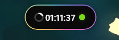

<div align="center">
  

# Wisland

A lightweight Windows desktop island for Codex, music, and focused workflows.

[](https://github.com/Lev1z/Wisland/releases/latest)
[](https://github.com/Lev1z/Wisland/releases)

[](LICENSE)

[简体中文](README.md) · **Eng**
</div>

Wisland presents Codex status and quota, media information, Obsidian notes, and temporary files in a top-edge capsule. Switch to the standard system tray to inspect local conversation trajectories and event details in a right-edge Runtime sidebar.

<p align="center">
  
</p>

## Highlights

- **Codex status and quota** — the outer concentric ring shows the weekly quota and the inner ring shows the five-hour quota; the status indicator distinguishes idle, running, and offline states.
- **Codex tray mode** — hide the capsule and keep only a status-colored quota ring in the standard Windows notification area. Hover for percentages or click for a Windows-style detail panel. Weekly-only accounts are supported.
- **Runtime timeline and Inspector** — incrementally follow local Codex JSONL in read-only mode, with turns, leading model headings, and tool results. Distinguish direct, sequential, and pending associations; resolve conversation names, select forks, read Markdown overviews, and inspect raw records inside the sidebar.
- **Music, lyrics, and controls** — read track metadata, artwork, progress, and playback state from Windows SMTC, with playback controls, volume, album-colored waveforms, and per-player lyric timing.
- **Obsidian quick notes** — append notes, tasks, and journal entries to a selected Vault and manage today's entries from the capsule.
- **Temporary file tray** — keep references to dropped files and drag them out or open them later without copying or modifying the originals.
- **Flexible navigation and appearance** — choose navigation, page order, scale, opacity, and capsule image/GIF assets. Dark/glass themes and rainbow/white borders are independent and apply across the capsule, settings, and sidebar.
- **Software updates** — check automatically at startup or manually from About; download only after confirmation and verify the updater signature before launching the installer.
- **Desktop behavior** — pin the expanded capsule with the middle mouse button, collapse it into a top bar, configure process/full-screen exclusions, start with Windows, and use the system tray.
- **Environment check** — verify WebView2, Codex Desktop, Codex CLI, Hooks, media services, and Obsidian on first launch, with contextual repair actions.

## Download and install

Download the latest `Wisland_<version>_x64-setup.exe` from [GitHub Releases](https://github.com/Lev1z/Wisland/releases/latest) and run it.

The installer is recommended over copying the standalone `Wisland.exe` from a build directory because it correctly configures upgrades, uninstall support, and Start menu shortcuts.

### Requirements

- 64-bit Windows 10 or Windows 11
- Microsoft Edge WebView2 Runtime (normally included with Windows 11)
- Optional: Codex Desktop and Codex CLI for status and quota features
- Optional: a media player that exposes Windows SMTC sessions
- Optional: Obsidian for quick notes

### v0.2.3 highlights

- Adds automatic update checks with explicit installation confirmation and signed updater assets. Failures open a themed dialog with a manual-download fallback.
- Separates theme and border settings across all surfaces; removes custom animated-border import while keeping capsule image/GIF assets.
- Uses a rounded Windows Composition visual for capsule glass instead of tinting its rectangular host. Prevents stacked tint from darkening the settings entrance animation.
- Simplifies settings copy and button hierarchy, shows friendly player names, aligns option cards, and makes context menus reflect the current display mode.
- [Full release notes (Chinese)](docs/releases/v0.2.3.md) · [Theme implementation (Chinese)](docs/themes.md) · [Development storage cleanup (Chinese)](docs/development-storage.md).

### v0.2.2 highlights

- Adds leading model headings with in-place pending association updates. Usage records no longer imply response completion; request start times and durations are not invented.
- Renders context rules and messages as readable Markdown, separates compaction summaries from retained history, and preserves unknown fields and raw records.
- Improves command, batch-output, and turn overviews. Related tools and technical details expand in one click; clicking the tray icon again hides the sidebar.
- Preserves actual fork hierarchy when parent conversations are missing or archived.
- Pauses automatic trajectory work while hidden, catches up on reopen, shares retained details, and centralizes status sampling without changing window materials, warm-up, or animations.
- [Full release notes (Chinese)](docs/releases/v0.2.2.md) · [Performance results and measurement limits (Chinese)](docs/performance.md).

### v0.2.1 highlights

- Replaces the tray popup with a 525-logical-pixel-wide, full-work-area Runtime sidebar that slides in from the right and stays visible without changing its material when unfocused.
- Adds a compact flat timeline and an Inspector drawer that preserves the original colored event column and list scroll position.
- Resolves Codex conversation names, merges rollouts belonging to one thread, and distinguishes actual forks. The bounded session picker uses compact branch labels.
- Adds type-specific overviews with safe Markdown, key facts first, deduplicated commands/results, expandable previews, and copying. Raw JSONL and mirror records now start fully expanded.
- Fixes capsule positioning after resolution, DPI, and work-area changes; updates About and version metadata to 0.2.1.
- [Full release notes (Chinese)](docs/releases/v0.2.1.md) · [Runtime guide and data scope (Chinese)](docs/runtime-sidebar.md).

### v0.1.5 highlights

- Adds standard system-tray mode, capsule context-menu switching, and a separate startup-mode preference.
- Colors the quota icon by task status and supports both dual-limit and weekly-only accounts.
- Adds a native Acrylic detail panel that reveals and retracts at the taskbar's upper edge; fixes animation borders, background flashes, and taskbar overlap.
- Updates status and quota independently in tray mode. About and the settings sidebar now read the application version at runtime.
- See the [tray animation implementation notes (Chinese)](docs/tray-animation-notes.md) for the investigation and regression checklist.

### v0.1.4 highlights

- Replaces the single Codex quota ring with two white concentric rings: weekly quota outside and five-hour quota inside.
- Shows both `1week` and `5h` remaining percentages together with the current task state below Page 1.
- Preserves the existing environment check, cache, and quota-service fallback behavior.

## Quick start

1. The first launch opens an environment check. Expand the capsule to inspect all results and resolve missing components.
2. Move the pointer over the capsule at the top center of the screen to expand it. It collapses roughly 0.5 seconds after the pointer leaves.
3. Scroll over the capsule to switch between the clock, music, journal, and file tray views.
4. Middle-click to pin or unpin the expanded state; right-click to open the shortcut menu.
5. Drag the capsule toward the top edge to collapse it into a small bar, then click the bar to restore it.
6. Install Hooks from the Codex settings page in Wisland and approve them when Codex requests trust.
7. Select an Obsidian Vault and daily-notes directory in Wisland settings to enable quick notes.

## Codex integration

### Capsule and tray modes

The right-edge Runtime sidebar provides a flat, DSH-inspired event timeline and an embedded Inspector. Version 0.2.2 adds leading model headings while retaining colored markers, compact labels, and turn numbers. Details distinguish direct associations from conservative sequential inference; pending output is not counted as a confirmed request, usage does not prove completion, and heading positions are not request start times. See the [data contract and test guide (Chinese)](docs/runtime-sidebar.md).

The keyboard-accessible session picker stays inside the sidebar and truncates long titles. Stable thread IDs resolve Codex names and merge multiple rollout files; actual forks remain separate and labeled. A read-only local index selects the current rollout, and bounded history references recover retained records. Missing or compressed history is reported explicitly.

Inspector overviews separate messages, commands, outputs, and recorded status facts. Technical fields are collapsed by default. Safe Markdown does not execute HTML or load remote images. The Raw tab opens JSONL and mirror records fully expanded, ready to scroll and copy; expansion does not recover data already truncated by the reader.

- Right-click the capsule and select “切换至托盘态” (switch to tray mode). Only the quota ring remains in the standard Windows notification area; there is no persistent floating window. Windows may place the icon in its overflow area; drag it into the visible tray area if preferred.
- The ring uses green for idle, orange for running, and gray for offline. The outer ring represents the weekly quota; the inner ring represents the five-hour quota.
- The tray uses one icon slot. Hover for `5h` / `1w` percentages. When the API reports no five-hour limit, only the weekly ring and weekly information appear. An absent limit is not treated as zero remaining quota.
- Click the tray icon for a 525-logical-pixel-wide sidebar spanning the work area above the taskbar. Quota rows stay at the top; a flat, scrollable event timeline fills the remainder. Click an event for its in-panel Inspector. Esc closes the session picker, then the Inspector, then the sidebar; Alt+F4 or the top-right hide button hides the sidebar directly. Focusing another window preserves visibility and the material appearance without taking focus back.
- Windows 11 build 22621 or later uses native Desktop Acrylic, rounded corners, and a shadow. The borderless sidebar slides left from the screen's right edge (about 240ms) and retracts right (about 170ms), clipped at that boundary. Animation updates follow Windows composition pacing. It follows the light/dark theme. Disabled transparency, high contrast, or Battery Saver uses an opaque background; disabled system animations use immediate show/hide. Earlier Windows versions retain the opaque fallback.
- Use “显示胶囊” (show capsule) in the tray menu to return. The header groups Refresh quota, Settings, and Hide in that order. Settings → General offers separate controls for the current mode and the next startup's default mode.
- Rust keeps tray status and quota polling active independently of the hidden capsule. Failed requests retain the latest successful data for up to six hours with a stale-data indicator. Manually starting an environment check returns to capsule mode.

Wisland uses Codex lifecycle Hooks to synchronize task start and completion states, and an authenticated Codex CLI session to retrieve quota information. Fully restart Codex after installing Hooks so that the new configuration is loaded.

The Hooks page in Codex App only queries hooks after it knows a project root. Before a project has been opened, the page may say that no hooks were found even though the runtime has loaded and executed them. Open a project and revisit the settings page; hook details shown below a Codex response also confirm that the configuration is active.

If PowerShell execution policy blocks `codex.ps1`, launch the command shim instead:

```powershell
& "$env:APPDATA\npm\codex.cmd"
```

## Views

### Clock / Codex

The center of the compact state shows the clock. On the left, the outer concentric ring represents the weekly Codex quota and the inner ring represents the five-hour quota. When expanded, the detail line uses `1week: xx% - 5h: xx% - status`. The right status indicator uses:

- Green: Codex is online and idle, or the latest task has completed
- Orange: Codex is executing a task
- Gray: Codex is not running, has exited, or its state is unavailable

Quota retrieval requires a separately installed and authenticated Codex CLI. Wisland reads account limits through `codex app-server`; temporary connection failures keep the latest successful value and mark it as pending refresh.

### Music

Wisland reads Windows SMTC media sessions, so the player must expose media information to Windows. If NetEase Cloud Music is not detected, enable system media controls (SMTC) in its system settings, then rerun the environment check from Wisland's Behavior settings.

### Obsidian

Wisland reads and writes only the local Vault you select. After configuring the daily-notes directory, you can add quick notes and tasks from the capsule. Confirm that the directory matches your existing Obsidian structure before writing.

### Temporary file tray

Dropped files are stored as paths in memory for the current session. The list is cleared when Wisland exits; original files are never modified, deleted, or uploaded.

## Development

Development requires Node.js LTS, Rust stable, WebView2, and the Windows C++ build tools required by Tauri 2.

### Project structure

```text
Wisland/
├─ src/                     # TypeScript frontend
│  ├─ modules/             # Capsule, media, Codex, and Obsidian features
│  ├─ runtime.ts           # Flat timeline, session selection, and Inspector drawer
│  ├─ runtime-detail*.ts   # Typed overviews, safe Markdown, and detail rendering
│  ├─ session-picker.ts    # Bounded conversation / fork picker
│  └─ assets/              # App icons and frontend assets
├─ public/
│  ├─ themes/              # Built-in capsule themes
│  ├─ third-party/         # Bundled frontend dependency licenses
│  └─ assets/visuals/      # Built-in image and animation assets
├─ src-tauri/               # Tauri / Rust desktop application
│  ├─ src/                 # Window, media, settings, logging, and OS integration
│  │  ├─ runtime.rs        # Read-only incremental JSONL reader and projection
│  │  ├─ runtime_catalog.rs # Names, current rollouts, and retained history
│  │  └─ display.rs        # Resolution, DPI, and work-area handling
│  ├─ icons/               # Windows and installer icons
│  └─ windows/             # NSIS installer extensions
├─ scripts/                 # Codex status Hooks and asset-generation utilities
├─ docs/assets/             # Images used by the README files
├─ index.html               # Main capsule window entry
├─ settings.html            # Settings window entry
├─ tray.html                # Codex Runtime sidebar opened from the tray icon
└─ package.json             # Frontend dependencies and development commands
```

```powershell
npm install
npm run tauri dev
```

Build the frontend:

```powershell
npm run build
```

Build the Windows application and NSIS installer:

```powershell
npm run tauri build
```

Default outputs:

- `src-tauri/target/release/wisland.exe`
- `src-tauri/target/release/bundle/nsis/Wisland_<version>_x64-setup.exe`

## Data and privacy

Wisland stores settings, Codex state, and logs in `%APPDATA%\wisland`. Obsidian content is written only to the selected local Vault, and the temporary file tray does not upload or copy files. Network requests for lyrics and Codex quota are made only when their corresponding features are used.

The Runtime sidebar reads local Codex JSONL, the name index, and the current-rollout database without modifying Codex data, uploading conversations, or accessing `auth.json`. History and detail payloads are bounded; information that was not recorded or exposed is not inferred.

## Technology

- [Tauri 2](https://tauri.app/)
- Rust and Windows APIs
- Vanilla TypeScript and Vite
- Windows System Media Transport Controls (SMTC)
- [Lyrix](https://crates.io/crates/lyrix)

## Acknowledgements

Wisland draws visual inspiration from PyIsland and evolved from the public `tauri-island` codebase. The current mainline has been streamlined and reworked around Codex and personal desktop workflows.

## License

This project is available under the [MIT License](LICENSE).
